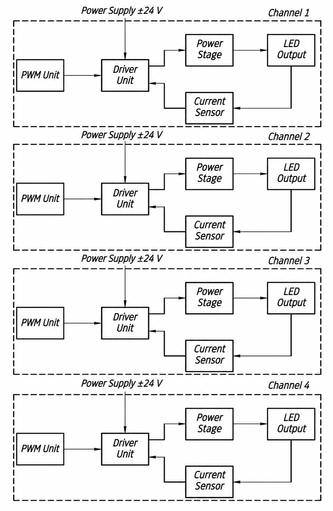
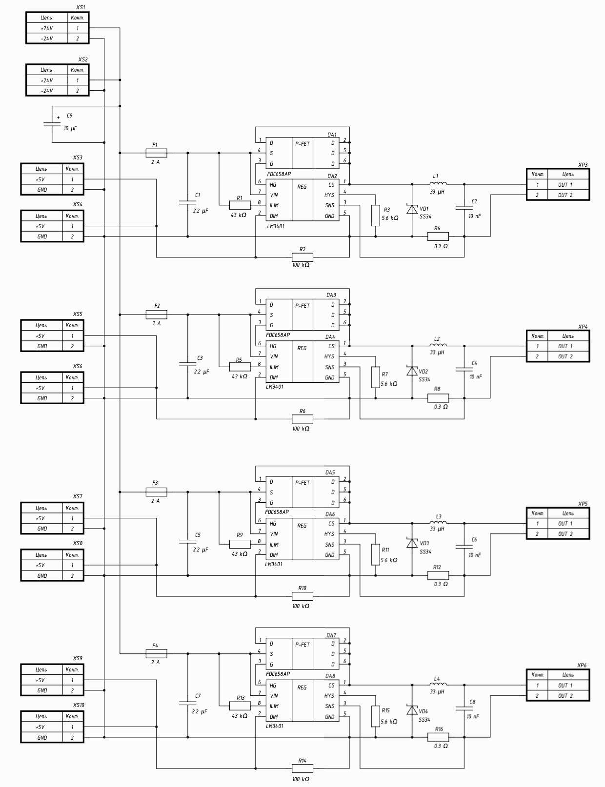
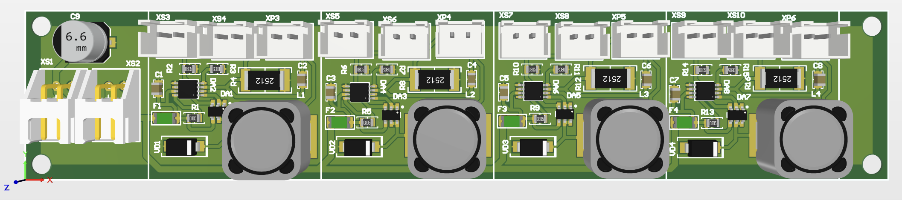
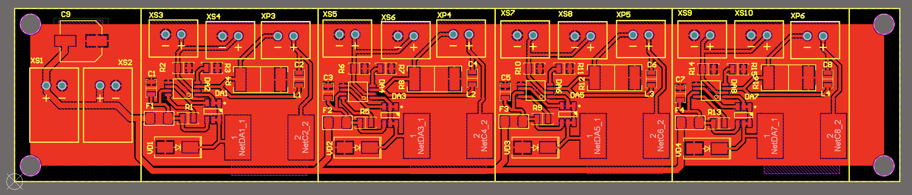
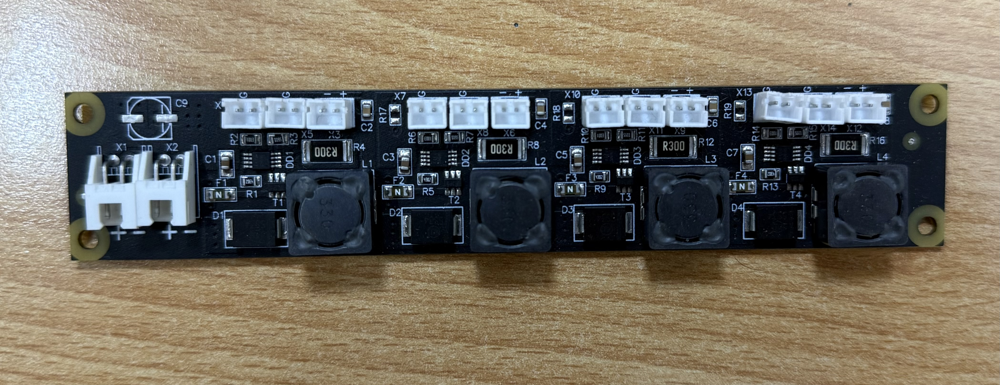

# Driver4CH

A four-channel LED driver board with external PWM brightness control. Each channel controls the duration of current pulses delivered to an LED string according to the PWM signal received from the control panel.

Each channel has its own LM3401 controller, external P-channel MOSFET, inductor, Schottky diode, current-sense resistor, and fuse. Current feedback regulates the LED current during the on-time, while the external PWM duty cycle controls its average value and therefore the brightness.

The repository contains the Altium Designer project, PCB views, fabrication files, BOM, and original Russian engineering documentation.

## Block Diagram

The four channels use the same circuit structure. An external PWM signal enters the driver unit, which controls the power stage. The current-sense feedback closes the regulation loop for each LED output. PWM generation is performed by the external controller.

## Schematic

LM3401 controllers DA2, DA4, DA6, and DA8 drive FDC658AP P-channel MOSFETs DA1, DA3, DA5, and DA7. Each channel forms a buck LED driver with a 33 µH inductor and an SS34 Schottky diode.

The 0.3 Ω resistors R4, R8, R12, and R16 provide current sensing. The associated resistor networks configure the controller. Each channel is supplied through its own 2 A fuse; this is a fuse rating, not an LED-current specification. C9 provides common input filtering, with local capacitors in each channel.

PWM commands connect to the DIM inputs. Each channel has two parallel control connectors, providing access to the same PWM signal and common return.

### Channel Mapping

| Channel | PWM connectors | Controller | MOSFET | Inductor | Current sense | Fuse | LED output |
| --- | --- | --- | --- | --- | --- | --- | --- |
| 1 | XS3 / XS4 | DA2 | DA1 | L1 | R4 | F1 | XP3 |
| 2 | XS5 / XS6 | DA4 | DA3 | L2 | R8 | F2 | XP4 |
| 3 | XS7 / XS8 | DA6 | DA5 | L3 | R12 | F3 | XP5 |
| 4 | XS9 / XS10 | DA8 | DA7 | L4 | R16 | F4 | XP6 |

### Connections

| Connectors | Pin 1 | Pin 2 | Function |
| --- | --- | --- | --- |
| XS1 / XS2 | +24 V label | −24 V label | Parallel power connections; labels reproduced from the schematic |
| XS3–XS10 | PWM / DIM (labelled +5 V) | GND | External channel control |
| XP3–XP6 | OUT 1 | OUT 2 | LED-string connections |

## PCB

### 3D View

### Top Layer

The elongated PCB contains four repeated driver sections and a common power-input section. Surface-mount components form the regulation and power stages; through-hole connectors provide the supply, PWM, and LED connections.

## Assembled Board

<!-- Uncomment after adding the photograph to hardware/images/pcb-real.jpg:

-->

> Photograph of the assembled board — to be added.

The board receives PWM commands from the external control panel and adjusts the brightness of the connected LED strings independently on four channels.

## Bill of Materials

| Designators | Qty | Value / Part | Description | Manufacturer | Part Number | Package |
| --- | ---: | --- | --- | --- | --- | --- |
| C1, C3, C5, C7 | 4 | 2.2 µF | Ceramic capacitor, 50 V, 10% | Yageo | CC0805KKX7R9BB225 | 0805 |
| C2, C4, C6, C8 | 4 | 10 nF | Ceramic capacitor, 250 V, 10% | Murata | GRM21BR72E103K | 0805 |
| C9 | 1 | 10 µF | Aluminum electrolytic capacitor, 50 V, 20% | JB Capacitors | JCK1H100M063054 | ECAP SMD |
| DA1, DA3, DA5, DA7 | 4 | FDC658AP | P-channel power MOSFET | ON Semiconductors | FDC658AP | SOT-23 |
| DA2, DA4, DA6, DA8 | 4 | LM3401 | Hysteretic LED driver controller | Texas Instruments | LM3401 | VSSOP-8 |
| F1, F2, F3, F4 | 4 | 2 A | Surface-mount fuse, 63 V | Littelfuse | 0466002.NR | 1206 |
| L1, L2, L3, L4 | 4 | 33 µH | Shielded power inductor, 15% | Bourns | SRR1208-330YL | SMD |
| R1, R5, R9, R13 | 4 | 43 kΩ | Chip resistor, 0.125 W | Yageo | RC0805JR-0743KL | 0805 |
| R2, R6, R10, R14 | 4 | 100 kΩ | Chip resistor, 0.125 W | Yageo | RT0805BRD07100KL | 0805 |
| R3, R7, R11, R15 | 4 | 5.6 kΩ | Chip resistor, 0.125 W | Yageo | RC0805JR-075K6L | 0805 |
| R4, R8, R12, R16 | 4 | 0.3 Ω | Current-sense resistor, 1 W, 1% | Yageo | RL2512FK-070R3L | 2512 |
| VD1, VD2, VD3, VD4 | 4 | SS34 | Schottky rectifier, 3 A, 40 V | YJ | SS34 | DO-14AB |
| XP3, XP4, XP5, XP6 | 4 | WB-02 | 2-pin connector | Ruichi | WB-02 | THT |
| XS1, XS2 | 2 | WK-02R | 2-pin connector (socket) | Hsuan Mao | WK-02R | THT |
| XS3, XS4, XS5, XS6, XS7, XS8, XS9, XS10 | 8 | WB-02 | 2-pin connector | Ruichi | WB-02 | THT |

[CSV BOM](docs/driver4ch.csv) · [Altium BOM document](hardware/altium/driver4ch.BomDoc)

## Documentation (Russian)

- [E1 — Block diagram](docs/original-ru/driver4ch_E1_block-diagram.pdf)
- [E3 — Schematic](docs/original-ru/driver4ch_E3_schematic.PDF)
- [PE3 — Parts list](docs/original-ru/driver4ch_PE3_part-list.pdf)
- [PP — PCB drawing](docs/original-ru/driver4ch_PP_board-drawing.PDF)
- [SB — Assembly drawing](docs/original-ru/driver4ch_SB_assembly-drawing.pdf)
- [SP — Product specification](docs/original-ru/driver4ch_SP_specification.pdf)

## Fabrication Files

[Gerber archive](fabrication/driver4ch_gerber.zip) · [STEP model](fabrication/driver4ch.step) · [Altium project](hardware/altium/driver4ch.PrjPcb)
